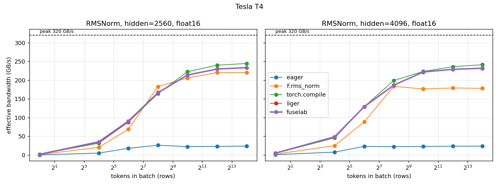
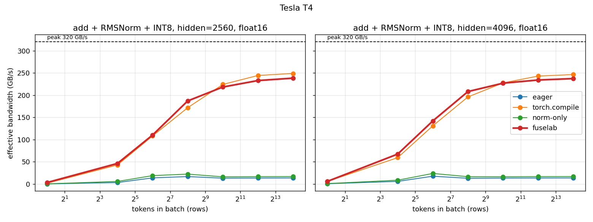

# fuselab

Hand-written, fused GPU kernels for LLM inference in [Triton](https://triton-lang.org), each one tested against PyTorch and benchmarked against honest baselines (`torch.compile`, Liger-Kernel), with the hardware ceiling drawn on the chart.

## Why fuse

A GPU is a kitchen with thousands of very fast cooks and a pantry down the hall. For most steps in an LLM the cooks wait on the walk to the pantry (memory), not on the maths. Plain PyTorch runs RMSNorm as several separate kernels, each one reading and writing the whole tensor. A fused kernel reads each row once, does all the maths in registers and writes once.

## Kernels

| Step | Kernel | Status |
|---|---|---|
| 1 | RMSNorm (`fuselab/rmsnorm.py`) | done: tested on a Tesla T4; results below |
| 2 | residual add + RMSNorm + INT8 quantise, one pass (`fuselab/add_rmsnorm_quant.py`) | done: tested on a Tesla T4; results below |
| 3 | final numbers on an H100, Nsight Compute profile, roofline | planned (needs a rented H100) |

## Results: RMSNorm on a Tesla T4 (Kaggle, fp16)



| hidden = 2560 (Qwen3-4B) | 1 token, µs (lower is better) | 16,384 tokens, GB/s (higher is better) |
|---|---|---|
| eager PyTorch | 46.8 | 23.6 (7% of peak) |
| `F.rms_norm` | 12.8 | 220.2 |
| `torch.compile` | 9.3 | **244.5 (76%)** |
| Liger-Kernel | 8.1 | 233.2 |
| **fuselab** | **7.7** | 233.4 (73%) |

- Single-token decoding (what a chatbot does while generating) is where fuselab is fastest: 6× eager, ahead of `torch.compile` and Liger. Hidden 4096 shows the same pattern (fuselab 4.86 µs, tied with Liger; `torch.compile` 5.74 µs).
- Large batches: `torch.compile` is about 5% ahead; fuselab ties Liger, which uses the same one-row-per-program design.
- Raw numbers: `results/rmsnorm_T4_fp16.csv`.
- A first run showed `torch.compile` as slow as eager at hidden 4096. That was the benchmark's fault: every new shape recompiles, and past the default limit of 8 it silently falls back to eager. The bench now compiles per hidden size with a higher limit.

## Results: residual add + RMSNorm + INT8 in one kernel (Tesla T4, fp16)

What a serving engine runs before every INT8 matmul: `residual = x + residual` (in place), RMSNorm, then
per-token quantisation (scale = max|y| / 127, round to int8). Plain PyTorch does it in about eight separate
passes over memory; this kernel reads `x` and `residual` once and writes `residual`, the int8 values and one
fp32 scale per token once.



| hidden = 2560, µs per call (lower is better) | 1 token | 64 tokens | 16,384 tokens |
|---|---|---|---|
| eager PyTorch | 127.9 | 84.0 | 21,756 |
| norm-only (PyTorch add → fuselab RMSNorm → PyTorch quantise) | 80.5 | 61.2 | 17,596 |
| `torch.compile` | 12.7 | 10.7 | **1,180** |
| **fuselab** | **7.0** | **10.5** | 1,233 |

- **Fusing only the norm buys 1.2–1.8× over eager. Fusing all three steps buys 8–18×** (18× at one token,
  17.6× at 16,384 tokens, least at 64).
- Against `torch.compile`, fuselab is faster at every batch up to 256 tokens, at both hidden sizes. That is
  decoding and small-batch serving. The big lead is one token at hidden 2560 (7.0 vs 12.7 µs, 1.8×); elsewhere
  the margin is 2–13%, and one token at hidden 4096 is a tie (6.2 vs 6.3 µs). From 1,024 tokens up,
  `torch.compile` is 0–5% ahead.
- Correctness: the residual matches PyTorch exactly, scales match, and int8 values differ by at most one rounding
  step (a value sitting on .5 after fp32 maths in a different order). Tests: `tests/test_add_rmsnorm_quant.py`.
  All 125 tests in the repo (both kernels) pass on the T4 across fp32, fp16 and bf16.
- T4 has no FP8, so this is INT8 (the format T4's tensor cores run). Raw numbers:
  `results/add_rmsnorm_quant_T4_fp16.csv`.

## Run

**Kaggle (free GPU):** upload `notebooks/fuselab_kaggle.ipynb`, set Accelerator to *GPU T4 x2*, turn Internet on, *Run All*. The notebook is generated from this repo's files by `scripts/make_notebook.py`.

**Any CUDA machine:**

```bash
pip install torch triton pytest matplotlib
pip install --no-deps liger-kernel   # optional baseline
python -m pytest -q tests
python bench/bench_rmsnorm.py --dtype float16
python bench/bench_add_rmsnorm_quant.py --dtype float16
```

**No GPU (correctness only, Triton's CPU interpreter):**

```bash
docker run --rm -v "$PWD":/w -w /w -e TRITON_INTERPRET=1 python:3.12-slim bash -c \
  "pip install -q torch --index-url https://download.pytorch.org/whl/cpu && pip install -q triton pytest numpy && python -m pytest -q tests"
```

## Method notes

- Correctness: each kernel is compared with a plain PyTorch reference (`rmsnorm_reference`, `add_rmsnorm_quant_reference`) over row counts 1 to 4096, hidden sizes including a non-power-of-two (1000), and fp32/fp16/bf16. RMSNorm is also tested on non-contiguous rows.
- Speed: `triton.testing.do_bench`, median of repeated runs after warm-up. Bandwidth counts only the bytes that must move: RMSNorm reads x and w and writes y; step 2 reads x, residual and w, and writes residual, the int8 values and one fp32 scale per token.
- Step 2 is timed with x = 0 so the in-place residual doesn't drift over thousands of calls. The memory traffic is the same.
- `torch.compile` is rebuilt for each hidden size with a raised recompile limit, so it never silently falls back to eager.
- Liger is run in its `gemma` casting mode with offset 0, which is the same formula as ours (all maths in fp32).
- bf16 is tested, but the benchmarks use fp16.
